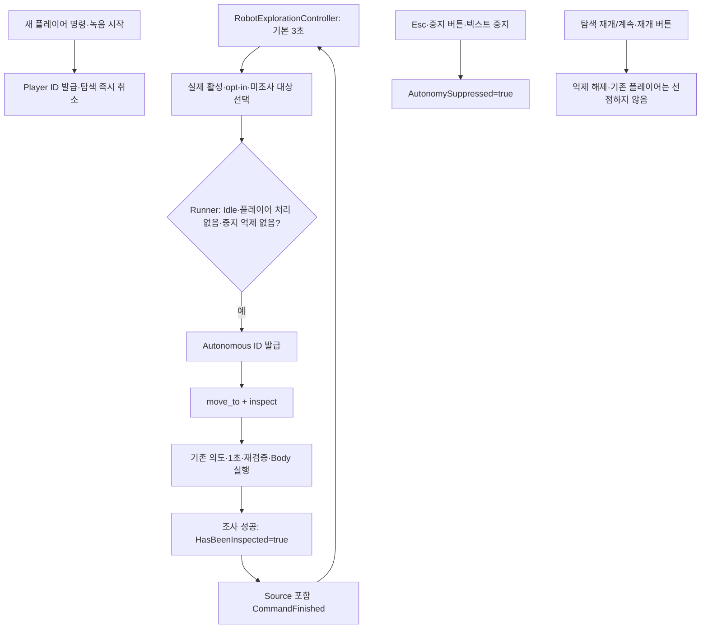
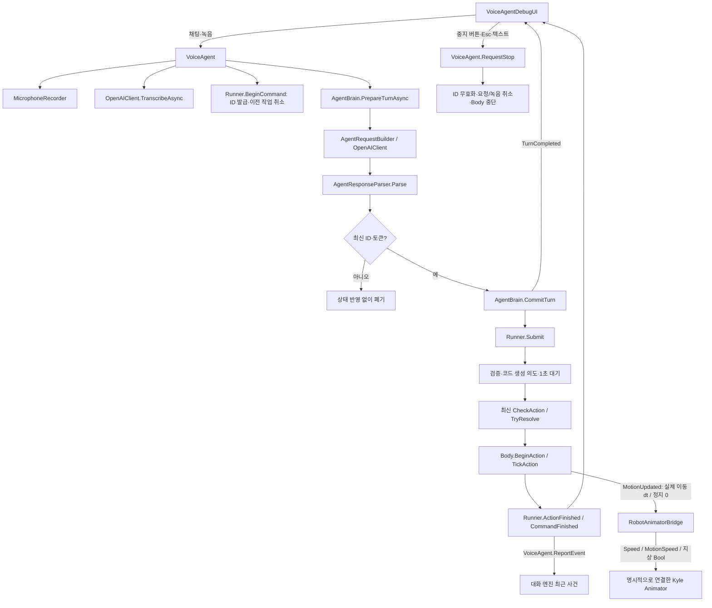

# VoiceAI 아키텍처

## 2026-11-11 — 독립된 사람·드론·AI 통합 시험

현재 통합 씬은 Assets/Scenes/VoiceAI_Integration_Test.unity다. SF 맵을 복제하여 HumanPlayer, Drone, AIRobot, VoiceAISystem과 시험 상자를 같은 씬에 저장했다. 기존 세 시험 씬은 수정하지 않았다.

- HumanPlayer / Drone은 기존 PlayerController / DroneController를 그대로 사용한다.
- ControlModeSwitcher는 카메라·AudioListener·커서·수동 입력 차단을 소유한다. 기존 serialized 참조와 externalInput=false 기본값을 유지한다. 선택적 IDroneAccessPolicy는 향후 앉은 상태 드론 진입 제한을 위한 연결점이다.
- VoiceAIIntegrationInput은 -200 실행 순서로 Enter/V/Tab/Esc/F를 조정한다. 외부 입력 모드에서 DebugUI의 키 처리를 끄며, 채팅이 열리면 수동 컨트롤러와 Tab만 차단한다. 게임 시간과 로봇 실행은 멈추지 않는다.
- AIRobot에는 Body / Exploration / AnimatorBridge를 연결한다. 사람·드론 컨트롤러는 부착하지 않는다. 현재 VisualRoot 아래 캡슐은 임시 외형이며 Animator 참조가 비어 있어도 예외가 나지 않는다.
- VoiceAgent / AgentBrain / Runner / Body의 해석·최신 작업 ID·1초 대기·재검증·취소 책임은 유지한다. 새 씬은 initializeApiOnAwake=false로 첫 실제 요청까지 API를 초기화하지 않는다. 기존 씬 기본값은 true다.
- SceneStageContext.useDemoObjectsWhenEmpty=false다. 실제 red_box/blue_box/yellow_box만 상호작용 대상으로 등록한다. F는 정보를 표시하고 InteractionRequested 이벤트를 보낼 뿐 퍼즐 상태나 조사 완료 플래그를 바꾸지 않는다.
- 채팅 중 컨트롤러 비활성화로 사람 중력도 잠시 멈춘다. 이후 입력 축만 차단하는 방식이 필요하면 별도로 개선한다.
- API 초기화 전 자율 탐색의 실행 결과는 월드 상태에 반영되지만 Brain 대화 이벤트에는 누적되지 않는다.

실제 연결과 Inspector 절차는 [INTEGRATION_TEST_GUIDE.md](INTEGRATION_TEST_GUIDE.md), 검증 결과는 TEST_PLAN을 따른다. 아래의 이전 날짜 설명은 해당 단계의 이력이다.

기준일: 2026-11-09 (Asia/Seoul). Unity 프로젝트 기록: 6000.3.25f1.

최신 코드 갱신: 2026-11-10 — 반자율 탐색 v0.1 추가. 새 탐색의 실제 Play Mode는 미실행이다. Kyle 걷기·이동 완료 후 Idle은 사용자 직접 성공 보고(U07/U08)이며, 애니메이션 연결 후 Esc 회귀는 미확인이다.

## 반자율 탐색 v0.1 — 현재 구현

새 [RobotExplorationController.cs](../../Assets/VoiceAI/Runtime/Unity/RobotExplorationController.cs)는 player에 사용자가 추가하는 opt-in 컴포넌트다. 별도 LLM/STT 호출 없이 실제 AgentInteractable 후보에서 `move_to → inspect` 계획만 만든다. 씬·Starter Assets 원본은 수정하지 않았다.

| 소유자 | 책임 |
|---|---|
| RobotExplorationController | 준비 후 3초 타이머·실제 후보·거리/ID 선택·실패 대상 기억. Runner 실행을 우회하지 않음 |
| AgentActionRunner | Player/Autonomous 출처·작업 ID·플레이어 우선·중지 억제·허용 동사·매 프레임 최신 검증·종료 결과 |
| AgentBodyController | 기존 이동/회전/조사. 실제 inspect 성공 시 대상 MarkInspected 호출 |
| AgentInteractable | allowAutonomousExploration(기본 false)·런타임 HasBeenInspected. 조사 기억은 퍼즐 state와 별도 |
| RobotAnimatorBridge | 기존 MotionUpdated로 동일하게 걷기/정지 처리. 이번에 변경하지 않음 |

### 타이밍과 우선순위

- 컴포넌트가 활성화되어 같은 씬 Body/VoiceAgent와 연결된 뒤 **idleDelaySeconds=3**, Time.deltaTime 기준으로 센다. timeScale=0에서는 진행하지 않는다.
- 일반 플레이어의 `CommandFinished(Completed)` 뒤 새 3초 타이머를 만든다. 해석 TurnCompleted 시점에는 시작하지 않는다. 실패·거부·취소 뒤에는 보수적으로 자동 재개하지 않는다.
- 새 플레이어 명령은 기존 작업을 무효화한다. 자율 작업은 active 작업·녹음·STT·LLM 중에는 진입할 수 없다.
- 명시적 RequestStop 및 해석 행동 stop은 Runner.Stop으로 AutonomySuppressed를 설정한다. 일반 명령을 이후 정상 완료해도 이 억제는 유지된다.
- `탐색 재개`, `탐색 계속`, 재개 버튼은 로컬 경로다. 억제를 해제하고 Idle이면 3초를 새로 센다. 진행 중 플레이어 요청을 취소하지 않는다. 음성 재개는 STT 후 LLM을 생략한다.
- 각 자율 행동에도 기존 의도 보고·1초 대기가 있다. 따라서 준비 약 3초 뒤 의도가 나오고 첫 실제 이동은 약 4초 뒤다. move_to 다음 inspect에도 별도 1초가 있다.
- 자율 작업 정상 종료 뒤도 기본 3초를 두고 다음 미조사 대상을 고른다. 후보가 없으면 이동 없이 Idle에서 후보를 재확인한다.

### 실제 후보·재검증·기억

활성 AgentInteractable 정적 등록 목록을 읽되 동일 씬·유일한 실제 ID를 TryResolve로 확인한다. 가짜 StageContext 데모 데이터는 선택에 사용하지 않는다. opt-out·비활성·공백/중복 ID·조사 완료·실패 기억·소지품·로봇 자신/자식/부모는 제외한다. 로봇 현재 위치에서 기본 반경 **10 Unity 단위(3D 거리)** 이내의 미조사 후보를 제곱 거리 오름차순, 동률이면 ordinal 고정 ID로 선택한다. 이미 조사한 대상은 자동 재선택하지 않는다.

Runner는 제출 시 자율 목록에 move_to/inspect 이외가 하나라도 있으면 전체를 거부한다. 실행 직전·프레임마다 실제 대상 opt-in·미조사·소지 여부·거리도 재검사한다. 반경은 작업 승인 시 값을 사용한다. 반경/대상 허용을 바꾸어도 초기 선택만으로 실행 권한을 보장하지 않는다.

조사 성공은 HasBeenInspected만 갱신하며 버튼·서랍·문·인벤토리·퍼즐 state는 변경하지 않는다. 플레이어 inspect도 같은 기억을 갱신한다. Failed/Rejected 대상 ID는 컴포넌트 수명 동안 재시도하지 않는다. 컴포넌트 메뉴 `Reset Failed Exploration Targets`는 실패 기억만 지우며 조사 완료 기억은 지우지 않는다. 플레이어 개입으로 취소한 미조사 대상은 나중에 다시 선택 가능하다.

종료 콜백은 Source와 CommandId를 함께 확인한다. 이전 자율 결과는 새 작업·타이머를 덮어쓰지 않으며 Runner의 기존 최신성 검사와 기억 확정 보호도 유지한다. 자율 계획에는 비동기 API 자체가 없다.

### 한계와 검증

새 탐색은 실제 Play Mode 미검증이다. 직선 이동에는 벽·낙하·시야·NavMesh·장애물 경로가 없으므로 10단위 이내여도 안전한 접근을 보장하지 않는다. 조사 상태는 런타임 인스턴스 기억이며 영구 저장하지 않는다. 명시적 중지는 재개 또는 새 Runner 인스턴스까지 유지한다. 안전한 단일 로봇·열린 공간에서 시험한다.

외부 백업: `C:\Dev\Capstune_design\_local_backups\VoiceAI-pre-exploration-v01-20261110`. 변경 전 원본 111개 SHA-256 일치, 별도 BACKUP_MANIFEST.json 1개. API 키·비밀·캐시 제외, 복사 직후 원본·Git 상태 유지 확인. 검증 재현은 TEST_PLAN과 Validation/README를 따른다.

## 상태 구분

- **현재 구현**: 이번 1차 리팩터링의 실제 C# 코드. Unity Play Mode 성공을 뜻하지 않는다.
- **기준 구조**: `8eaae6a14e5ad7e4cba14a55cd340f0cddde5745`, 태그 `checkpoint/voiceai-before-runner`의 코드.
- **후속 계획**: 아직 구현하지 않은 기능. [ROBOT_DESIGN.md](ROBOT_DESIGN.md), [REFACTOR_PLAN.md](REFACTOR_PLAN.md)는 전체 목표와 당시 계획이며 현재 구현 범위는 이 문서를 따른다.

1차 리팩터링은 Assets/VoiceAI와 Docs/VoiceAI에서 수행했다. 11월 9일 사용자 시험 결과 반영은 문서만 변경했고, 11월 10일 걷기 연결은 Body·신규 Bridge와 문서/검증 도구만 변경했다. 씬·Starter Assets·Packages·ProjectSettings·비밀 파일은 변경하지 않는다. [검증](TEST_PLAN.md), [변경 이력](CHANGELOG.md)을 함께 참고한다.

## 1. 기준 구조와 바뀐 이유

기준 구조는 `VoiceAgent → AgentBrain.RunTurnAsync → TurnCompleted → AgentBodyController.HandleTurn → 코루틴 목록 실행`이었다. VoiceAgent는 해석 후 Idle이 되어 실제 실행 상태를 알지 못했고, 새 응답에 행동이 있을 때만 Body의 StopAllCoroutines가 호출되었다. 중지는 API 응답에 의존하고, 요청별 ID·취소·늦은 응답 무효화·행동 전 대기·실행 결과 계약이 없었다.

AgentBrain은 응답 후 곧바로 신뢰도·기억을 변경했다. 이벤트만 막는 방식으로는 취소된 응답의 부작용을 차단할 수 없었다. 또한 검사 시점과 실행 시점 사이에 대상 상태가 변할 수 있었고, 실패해도 다음 행동을 계속할 수 있었다.

## 2. 현재 클래스와 책임

모든 런타임 클래스의 네임스페이스는 `AgentEscape.VoiceAI`이다. 경로 접두사는 `Assets/VoiceAI/`이다.

| 파일 / 클래스 | 실제 역할 |
|---|---|
| [VoiceAgent.cs](../../Assets/VoiceAI/Runtime/Unity/VoiceAgent.cs) / VoiceAgent | 입력·녹음·STT·LLM 조정, 명령별 연결 토큰, 최신 결과 검사·확정. 로컬 RequestStop 제공. 입력 상태는 Idle/Recording/Transcribing/Thinking |
| [AgentActionRunner.cs](../../Assets/VoiceAI/Runtime/Unity/AgentActionRunner.cs) / AgentActionRunner | 실행 권한의 단독 소유자. Player/Autonomous 출처·우선순위·중지 억제·작업 ID·의도·대기·검증·종료. VoiceAgent와 같은 GameObject에서 자동 준비 |
| [RobotExplorationController.cs](../../Assets/VoiceAI/Runtime/Unity/RobotExplorationController.cs) / RobotExplorationController | player의 탐색 제안자. 타이머·후보 선택·실패 기억. 수동 컴포넌트 추가와 대상 opt-in 필요 |
| [AgentBodyController.cs](../../Assets/VoiceAI/Runtime/Unity/AgentBodyController.cs) / AgentBodyController | BeginAction/TickAction/CancelCurrentAction으로 단일 행동만 수행. 직선 Transform 이동·이동 방향 회전. 실제 위치 갱신 후 MotionUpdated(deltaTime), 정지/취소 시 MotionUpdated(0) 발행 |
| [RobotAnimatorBridge.cs](../../Assets/VoiceAI/Runtime/Unity/RobotAnimatorBridge.cs) / RobotAnimatorBridge | Body 변위에서 실제 수평 속도를 측정해 StarterAssetsThirdPerson 파라미터만 설정. Transform·Animator.speed는 변경하지 않음. 필수 Animator는 Inspector에서 명시 연결 |
| [VoiceAgentDebugUI.cs](../../Assets/VoiceAI/Runtime/Unity/VoiceAgentDebugUI.cs) / VoiceAgentDebugUI | 채팅·V키·녹음 버튼·중지 버튼·Esc. 입력/실행 상태·ID·의도·결과 표시. 명명된 이벤트 핸들러 해제와 로그 길이 제한 |
| [AgentBrain.cs](../../Assets/VoiceAI/Runtime/Core/AgentBrain.cs) / AgentBrain | PrepareTurnAsync는 전송·파싱만 수행. CommitTurn은 유효 턴만 신뢰도·기억에 반영. 기존 RunTurnAsync 래퍼 유지 |
| [AgentModels.cs](../../Assets/VoiceAI/Runtime/Core/AgentModels.cs) | 기존 행동·응답·상태 DTO, AgentCommandId, AgentExecutionState/Outcome, AgentExecutionResult, PreparedAgentTurn |
| [AgentCommandRules.cs](../../Assets/VoiceAI/Runtime/Core/AgentCommandRules.cs) / AgentCommandRules | 전체 문장 일치 로컬 중지와 행동 복사. 대상 우선순위·복잡한 규칙 오해는 아직 구현하지 않음 |
| [AgentResponseParser.cs](../../Assets/VoiceAI/Runtime/Core/AgentResponseParser.cs) / AgentResponseParser | API JSON 파싱, 질문/거부 행동 금지, 미지원 동사·null 방어. 계획 검증과 최신 실행 CheckAction에서 인벤토리 검사 시점 분리 |
| [SceneStageContext.cs](../../Assets/VoiceAI/Runtime/Unity/SceneStageContext.cs) / SceneStageContext | 같은 씬 활성 대상 스냅샷. TryResolve는 실제 활성 대상이 유일할 때만 성공 |
| [AgentInteractable.cs](../../Assets/VoiceAI/Runtime/Unity/AgentInteractable.cs) / AgentInteractable | 대상 메타데이터·활성 등록·탐색 opt-in·런타임 조사 기억. 퍼즐 실행 로직은 없음 |
| [OpenAIClient.cs](../../Assets/VoiceAI/Runtime/Unity/OpenAIClient.cs) / OpenAIClient | 기존 STT·Responses HTTP 형식·모델·재시도 유지. 전송 시도 전 취소 검사 추가 |
| [MicrophoneRecorder.cs](../../Assets/VoiceAI/Runtime/Unity/MicrophoneRecorder.cs) / MicrophoneRecorder, RecordedAudio | 기존 마이크·WAV·RMS 처리 유지. VoiceAgent가 Stop 예외와 취소를 처리 |
| [OpenAIKeyProvider.cs](../../Assets/VoiceAI/Runtime/Unity/OpenAIKeyProvider.cs) / OpenAIKeyProvider | 기존 키 로더 유지. 키 파일은 이번 작업에서 읽지 않음 |
| [WavEncoder.cs](../../Assets/VoiceAI/Runtime/Core/WavEncoder.cs), [MultipartFormData.cs](../../Assets/VoiceAI/Runtime/Core/MultipartFormData.cs), [AgentApiException.cs](../../Assets/VoiceAI/Runtime/Core/AgentApiException.cs) | 오디오 변환·업로드 본문·오류 표현 재사용 |
| [FrustrationDirector.cs](../../Assets/VoiceAI/Runtime/Core/FrustrationDirector.cs) / FrustrationDirector, TurnDirective | 기존 타입 보존. 새 Brain 경로는 무작위 Decide/Report를 호출하지 않음. 생성자 매개변수는 호출 호환용 |

기존 모델 값·프롬프트 파일·STT 업로드 형식은 유지했다. 무작위 강제 오해 지시만 새 요청에서 사용하지 않는다. 이는 완전한 규칙 기반 오해 구현을 뜻하지 않는다.

## 3. 현재 실제 호출 관계

## 4. ID·입력 교체·기억 보호

- Runner는 세션 GUID와 증가하는 Sequence로 AgentCommandId를 만든다. LLM 응답에서 ID를 받지 않는다. 각 행동은 ActionIndex로 식별한다.
- 새 채팅이나 녹음 시작이 이전 작업·요청·자율 탐색을 취소한다. 처리 중 새 플레이어 명령도 받는다. 자율 출처는 Idle에서만 시작하며 실제 move_to/inspect로 제한된다.
- VoiceAgent는 수명 토큰과 요청별 연결 토큰을 분리한다. STT 후·LLM 후·Commit 전·이벤트 후·Submit 전에 최신 ID/토큰을 검사한다. 오래된 오류도 표시하지 않는다.
- PrepareTurnAsync는 공유 기억·신뢰도·무작위 상태를 변경하지 않는다. CommitTurn은 소유 Brain, revision, 중복 확정, 취소 토큰을 확인한다. 최신성 검사와 Commit 사이에 await나 외부 이벤트가 없다.
- ResetConversation은 현재 작업을 취소하고 Brain revision을 바꾼다. 비활성화·파괴 시 요청·녹음·실행을 정리한다. 세션 GUID는 Runner 인스턴스 수명 동안 유지되고 작업 Sequence는 계속 증가한다.
- 유효하게 해석·확정된 뒤 실행이 취소된 턴의 기억은 유지한다. 취소 전에 이미 완료된 조작도 되돌리지 않는다.

## 5. 실행 상태·대기·재검증

Runner 상태는 Idle → AwaitingInterpretation → Announcing → Waiting → Executing이다. 행동 성공 뒤 다음 행동은 다시 의도·대기를 거친다. 종료 결과는 Completed/Cancelled/Rejected/Failed이며 CommandFinished는 작업당 한 번 발생한다.

기본 intentDelaySeconds는 1초이며 Time.deltaTime 기준이다. timeScale=0에서는 대기·실행이 진행되지 않고 UI 중지는 가능하다. 의도는 실제 유일한 대상의 displayName과 지원 동사·정규화된 걸음 수로 코드가 생성한다. LLM speech를 실행 의도로 신뢰하지 않는다.

계획 단계에서는 구조·지원 동사·허용 대상 등을 검사하고 인벤토리 변동 검사는 미룬다. 거부된 행동이 하나라도 있으면 나머지 승인 행동도 실행하지 않는 보수적 정책이다. 각 행동 시작 전, 대기 뒤, 실행 프레임마다 최신 상태를 검사한다. 접근 완료 다음 프레임에 다시 검증한 뒤 집기 등을 수행한다. 대상 이동·소멸·중복 ID·권한 변경·소지 조건 실패 시 후속 행동을 중단한다.

기존 스키마의 item은 초기 인벤토리에 제한되어 있고 use 자체가 이번 단계에서 미지원이다. 따라서 열쇠 집기→사용 퍼즐 지원이 완료된 것은 아니다. 집기→내려놓기는 실행 시 인벤토리로 검증한다.

Body는 직접 Transform 이동을 유지한다. 이동 속도 오류와 기본 30초 행동 제한을 처리한다. 벽·낙하·NavMesh·Rigidbody의 안전한 운용은 아직 보장하지 않는다.

## 6. 중지와 이벤트 계약

로컬 텍스트: 중지/멈춰/멈춰줘/멈춰 줘/멈춰요/취소/정지/stop/cancel. 앞뒤 공백과 문장 끝 .!? 등은 허용한다. 부분 문자열은 사용하지 않아 “멈추지 말고 가”는 로컬 중지가 아니다.

중지 버튼·Esc·텍스트는 API를 호출하지 않는다. 키/프롬프트 초기화 실패 상태에서도 RequestStop이 동작한다. STT 처리 후 인식된 중지도 LLM을 생략하지만, 그 전 STT 지연까지 제거하는 로컬 음성 인식은 없다.

`stop` 행동에 도달하면 나머지 행동을 폐기한다. Body는 더 이상 TurnCompleted를 구독하지 않아 중복 실행 경로가 없다.

- TurnCompleted: 기존 시그니처 유지, 해석 완료 또는 현재 요청의 오류 대체 대사. 실행 성공 이벤트가 아님.
- Runner.IntentAnnounced/ExecutionStateChanged: 의도와 실행 상태.
- Runner.ActionFinished: 실제 Body 실행이 종료된 행동의 결과.
- Runner.CommandFinished: 작업 전체 종료. 시작 전 거부·취소는 이 이벤트로 보고.
- VoiceAgent.LocalNotice: 작업이 없는 중지를 포함한 로컬 알림.

이벤트 구독자 예외는 개별 격리한다. 외부 코드가 TurnCompleted.Actions를 직접 실행하면 중복이 생기므로 제거하고 Runner 결과만 관찰해야 한다. SendChat의 bool은 새 입력 접수 여부이며, 처리 중 교체 입력도 true이다.

## 7. 연결·한계·후속 계획

기존 씬에서 VoiceAgent는 같은 GameObject의 Runner를 사용하거나 런타임에 추가한다. Body는 같은 씬의 VoiceAgent가 유일하면 자동 등록한다. 여러 VoiceAgent가 있으면 Body.voiceAgent를 Inspector에서 지정해야 하며, 한 Runner에 여러 Body를 연결하는 것은 오류다. 씬 파일은 수정하지 않았다.

자율 탐색 v0.1·3초 재개는 위 범위로 구현했다. 힌트·퍼즐·TTS·정교한 안전 판단·플레이어 자연어 대상 선택 우선순위는 미구현이다. Kyle은 기존 Body 이동에 걷기 표현을 연결했고 사용자 걷기·완료 Idle 성공 보고가 있다. 전용 이동 컨트롤러·점프·달리기·손 집기는 미구현이다. 새 Brain은 무작위 오해를 요청하지 않지만 자연어 정확성 자체를 보장하지 않는다.

이전 [ROBOT_KYLE_INTEGRATION_PLAN.md](ROBOT_KYLE_INTEGRATION_PLAN.md)는 11월 9일 조사 당시 계획이다. 11월 10일 실제 Import 에셋을 확인하고 RobotAnimatorBridge를 구현했다. 전용 이동 어댑터는 여전히 없으며 새 설정·시험 절차는 [TEST_PLAN.md](TEST_PLAN.md)의 Kyle 절을 따른다.

### Kyle 실제 에셋·Animator 계약 (2026-11-10)

근거: `Assets/Starter Assets/Runtime/ThirdPersonController/Character/Animations/StarterAssetsThirdPerson.controller`, 같은 폴더의 Idle/Walk/Run FBX .meta, `Assets/Starter Assets/Runtime/SpaceRobotKyle/Models/KyleRobot.fbx.meta`와 Prefabs/KyleRobot.prefab. 원본 파일은 수정하지 않았다.

| 파라미터 | 실제 타입 | Bridge 값과 이유 |
|---|---|---|
| Speed | Float | 0=Idle, 최대 2=Walk. 실제 속도를 그대로 넣어 Run(6)과 섞지 않음 |
| MotionSpeed | Float | 실제 수평 속도 / walkReferenceSpeed, 0.1~3 배수. Idle에서는 1로 두어 Idle 재생을 얼리지 않음 |
| Grounded | Bool | true. 지상 전용 표현이며 물리적 접지 센서는 아님 |
| Jump | Bool | false. 점프 미구현 |
| FreeFall | Bool | false. 낙하 표현 미구현 |

실제 기본 상태는 `Base Layer.Idle Walk Run Blend`이며 1D BlendTree의 Speed 임계값 0/2/6이 Idle/Walk_N/Run_N 클립 GUID에 연결된다. 별도의 Idle→Walk 전환선이 있는 구조가 아니다. 이 상태는 `m_SpeedParameterActive=1`, `m_SpeedParameter=MotionSpeed`로 재생 배수를 사용한다. Jump=true이면 JumpStart, FreeFall=true이면 InAir로 전환할 수 있으므로 Bridge가 지상 Bool을 명시 설정한다. 두 Float 기본값이 0이어서 외부 드라이버가 없으면 실제 위치만 이동하면서 Walk가 선택되지 않고 클립 재생도 정지할 수 있다.

Kyle와 Idle/Walk/Run은 `animationType: 3`(Humanoid)이며 Kyle `avatarSetup: 1`, 클립 `avatarSetup: 2`다. Kyle humanDescription에 Hips/Spine/Head/양쪽 다리 매핑이 있고 클립은 loopTime=1이다. Humanoid 리타기팅을 사용할 수 있는 설정 근거는 있으나 native Avatar 유효성·자세 호환은 Unity Inspector/Play Mode 미검증이다. 클립의 lastHumanDescriptionAvatarSource GUID `36078ab0369161e49a29d349ae3e0739`는 현재 메타 검색에서 대응 파일을 찾지 못했다. 이 필드만으로 애니메이션 실패라고 단정하지 않으며 Rig/Avatar 유효성을 사용자 확인한다.

저장된 ssm.unity에는 Animator 두 개가 있다. Controller GUID `40db3173a05ae3242b1c182a09b0a183`가 연결되고 Root Motion=0인 KyleRobot의 Animator가 대상이다. 다른 KyleRobot Animator는 Controller 없음·Root Motion=1로 저장되어 있어 자동 탐색하지 않는다. 사용자 Hierarchy와 Inspector에서 실제 제어 대상을 확인하고 중복 Animator가 같은 뼈를 제어하지 않게 한다. 씬은 자동 수정하지 않았다.

### 이동·정지·애니메이션 책임

Body는 기존 목적지·직선 변위를 유지하고 move_direction에서도 목적지 방향으로 RotateTowards를 수행한다. 뒤/좌/우 명령은 명령 접수 당시 로봇 축으로 목적지를 잡은 뒤 그쪽을 바라본다. 후속 방향 명령의 기준은 새로 회전한 로봇 방향이다.

Bridge는 Body 위치 갱신 직후 이벤트의 dt로 변위를 나눠 실제 수평 속도를 계산한다. 이동 진입 Speed는 기본 0.12초 동안 2까지 올린다. 정지·완료·취소는 MotionUpdated(0)으로 Speed=0을 즉시 전달하여 감쇠 잔여 걷기를 남기지 않는다. LateUpdate에서도 Body 정지/비활성/일시정지의 Idle 값을 보강한다. 정지 시각의 시각적 포즈 자연스러움·발 미끄러짐은 native Play Mode에서 확인해야 한다.

walkReferenceSpeed=2는 조정 가능한 초기 보정값이며 FBX의 실제 평균 속도를 측정한 결과가 아니다. 기본 Body 속도 3이면 MotionSpeed=1.5이며 발맞춤에 따라 Inspector에서 보정한다. Bridge는 파라미터 이름과 타입을 확인해 잘못된 Controller에는 쓰지 않으며 Animator 참조가 없으면 동작을 생략한다. Root Motion은 연결된 Animator에서 런타임에 끄고 위치/회전은 Body만 변경한다. 별도 OnAnimatorMove나 제3 이동 스크립트의 영향까지 제거하는 코드는 없다.

## 8. 수행한 검증과 보안

설치된 Unity 6.3 DLL과 로컬 Newtonsoft.Json을 참조한 전체 런타임 C# 빌드, 네트워크/Unity 대체 환경의 동작 시험을 수행했다. 자세한 명령·결과·한계는 [Validation/README.md](Validation/README.md)에 있다. 이는 Unity Editor 컴파일 또는 Play Mode 시험이 아니다.

**사용자 직접 시험 결과 추가(보고 기록일 2026-11-09):** Play Mode 정상 실행·Console 오류 0개, 채팅 상자 집기, AI 해석 후 큐브 이동·집기, 이동 중 Esc로 중지·Cancelled, 예고 후 1초 대기 중 Esc 취소, 실제 마이크 STT→AI 해석→행동 실행이 성공했다. Codex 직접 실행이나 자동화 결과가 아니며 상세 근거와 미확인 범위는 TEST_PLAN의 U01~U06을 따른다. 정밀 타이밍·이벤트 횟수·LLM 처리 중 취소·늦은 응답의 실제 Unity 검증까지 확대하지 않는다.

Codex는 키·인증 헤더를 출력하거나 실제 API를 호출하지 않았다. 실제 마이크·STT·해석 연결 성공은 사용자의 실행 보고이다. 이전 자동 시험 키 로더는 실제 파일을 열지 않는 대체 구현이다. 개발용 API 오류 표시 정책·공개 배포 중계 인증은 후속 검토 대상이다.
