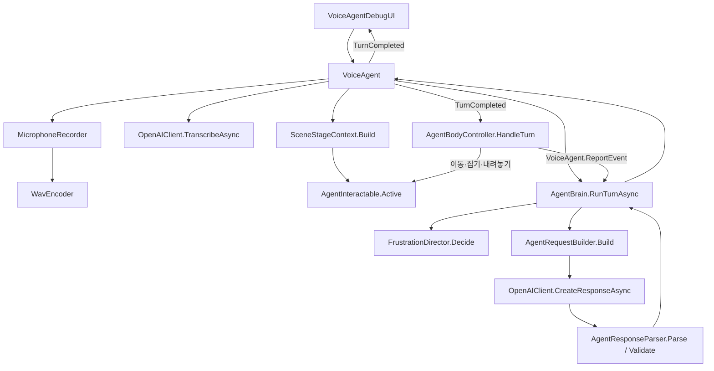
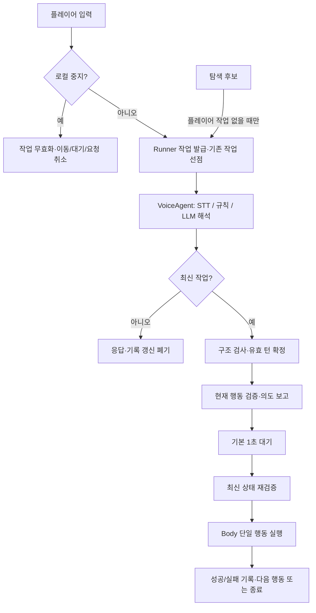

# VoiceAI 아키텍처

작성 기준: 2026-11-09 (Asia/Seoul). Unity 프로젝트 기록: 6000.3.25f1.

## 문서 상태와 범위

- **현재 구현**: 저장소 코드에서 확인한 사실. Unity 실행 성공을 의미하지 않는다.
- **확정 설계 / 미구현**: 사용자 요구로 확정되었으나 코드에 반영되지 않은 규칙.
- **구현 제안**: 리팩터링을 위한 클래스·API·상태 설계. 구현 전 조정 가능하다.
- **미확정**: 세부 기획 또는 기술 선택이 더 필요한 사항.

이번 작업은 문서 작성만 수행했다. C#·씬·패키지·설정은 변경하지 않았으며 Unity 컴파일, Play Mode, 실제 API 시험은 수행하지 않았다. 비밀 파일은 읽지 않았다. 로컬 코드 근거는 아래 상대 링크를 사용한다.

관련 문서: [로봇 설계](ROBOT_DESIGN.md), [리팩터링 계획](REFACTOR_PLAN.md), [시험 계획](TEST_PLAN.md), [변경 이력](CHANGELOG.md).

## 1. 현재 실제 구현

모든 C# 클래스는 `AgentEscape.VoiceAI` 네임스페이스에 있다.

| 파일 / 클래스 | 현재 책임과 실제 연결 |
|---|---|
| [VoiceAgentDebugUI.cs](../../Assets/VoiceAI/Runtime/Unity/VoiceAgentDebugUI.cs) / `VoiceAgentDebugUI` | IMGUI 채팅·V키·녹음 버튼. `VoiceAgent.SendChat`, `StartVoiceInput`, `StopVoiceInput` 호출. 상태·전사·턴·오류 이벤트 표시 |
| [VoiceAgent.cs](../../Assets/VoiceAI/Runtime/Unity/VoiceAgent.cs) / `VoiceAgent`, `VoiceAgentState` | 프롬프트·키 로딩, 녹음·STT·LLM 조정. `Idle/Recording/Transcribing/Thinking` 관리. `TurnCompleted` 발행 |
| [MicrophoneRecorder.cs](../../Assets/VoiceAI/Runtime/Unity/MicrophoneRecorder.cs) / `MicrophoneRecorder`, `RecordedAudio` | 첫 마이크 녹음, WAV·시간·RMS 반환. `WavEncoder` 호출 |
| [OpenAIClient.cs](../../Assets/VoiceAI/Runtime/Unity/OpenAIClient.cs) / `OpenAIClient` | STT·응답 생성 HTTP 요청. 요청당 30초 제한, 최대 3회 시도. 토큰 취소 시 Abort |
| [OpenAIKeyProvider.cs](../../Assets/VoiceAI/Runtime/Unity/OpenAIKeyProvider.cs) / `OpenAIKeyProvider` | 로컬 파일 우선, 환경 변수 차선으로 키 로딩. 이 문서 작업에서는 비밀 파일을 열지 않음 |
| [SceneStageContext.cs](../../Assets/VoiceAI/Runtime/Unity/SceneStageContext.cs) / `SceneStageContext` | 활성 대상·설명·위치·인벤토리로 `StageContext` 스냅샷 생성 |
| [AgentInteractable.cs](../../Assets/VoiceAI/Runtime/Unity/AgentInteractable.cs) / `AgentInteractable` | 정적 활성 목록 등록, 대상 ID·허용 동사·상태·신뢰도 저장. 퍼즐 실행 기능 없음 |
| [AgentBodyController.cs](../../Assets/VoiceAI/Runtime/Unity/AgentBodyController.cs) / `AgentBodyController` | `TurnCompleted` 구독, 기존 코루틴 중단, 행동 목록 순차 실행, 인벤토리·위치 갱신·사건 보고 |
| [AgentBrain.cs](../../Assets/VoiceAI/Runtime/Core/AgentBrain.cs) / `AgentBrain` | 턴 처리·신뢰도·대화 메시지 12개·최근 사건 8개. 전송 함수를 주입받으며 Unity API에 의존하지 않음 |
| [AgentRequestBuilder.cs](../../Assets/VoiceAI/Runtime/Core/AgentRequestBuilder.cs) / `AgentRequestBuilder`, `ChatTurn`, `LlmSettings` | 프롬프트·기록·developer 상태·user 발화 및 구조화 응답 스키마 생성 |
| [AgentResponseParser.cs](../../Assets/VoiceAI/Runtime/Core/AgentResponseParser.cs) / `AgentResponseParser` | 완료 상태·거부·JSON 파싱. 대상·허용 동사·소지 아이템·신뢰도 검사, 승인 최대 5개, 이동 1~10걸음 제한 |
| [AgentModels.cs](../../Assets/VoiceAI/Runtime/Core/AgentModels.cs) / `AgentVocabulary`, `AgentAction`, `AgentResponse`, `RejectedAction`, `AgentTurnResult`, `StageObject`, `StageContext` | 허용 어휘·행동·응답·상태 DTO. 작업 ID와 실제 실행 결과 없음 |
| [FrustrationDirector.cs](../../Assets/VoiceAI/Runtime/Core/FrustrationDirector.cs) / `FrustrationDirector`, `TurnDirective` | 혼란도별 확률로 강제 오해 선택. LLM comprehension으로 연속 실패 계산 |
| [WavEncoder.cs](../../Assets/VoiceAI/Runtime/Core/WavEncoder.cs) / `WavEncoder` | 16bit PCM WAV 인코딩과 RMS 계산 |
| [MultipartFormData.cs](../../Assets/VoiceAI/Runtime/Core/MultipartFormData.cs) / `MultipartFormData` | STT multipart 업로드 본문 구성 |
| [AgentApiException.cs](../../Assets/VoiceAI/Runtime/Core/AgentApiException.cs) / `AgentApiException` | 공통 API·설정 오류 표현 |
| [agent_system.txt](../../Assets/VoiceAI/Resources/VoiceAI/Prompts/agent_system.txt) | 말투·신뢰·행동 예시·강제 오해 지침. 실제 실행 코드가 아님 |

### 실제 호출 관계

채팅은 STT를 생략한다. 음성은 0.3초 미만 또는 RMS 0.002 미만을 걸러낸다. STT 결과로 LLM 요청을 수행한 뒤 `AgentBrain`이 신뢰도와 기록을 갱신한다. `VoiceAgent`는 `Idle`로 바꾸고 `TurnCompleted`를 발행한다. Body의 코루틴 실행 완료를 기다리지 않는다.

### 구현 범위

- 실행 분기 있음: `move_to`, `move_direction`, `inspect`, `pick_up`, `drop`, `wait`, `stop`.
- `stop`은 새 행동 응답 수신 시 코루틴을 교체하는 효과에 의존한다. 즉시 중지 경로가 아니다. 목록에서 stop 다음 행동도 계속될 수 있다.
- 어휘만 존재하고 실행 미구현: `follow_drone`, `open`, `close`, `push`, `pull`, `press`, `use`.
- 자율 탐색·1초 실행 전 대기·명령 ID·명령별 취소·퍼즐 상태 머신·TTS·감정 애니메이션은 없다.
- `SceneStageContext.AddDemoObjects`는 가상 상태 데이터만 만든다. 실제 문·책상 등의 GameObject를 생성하지 않는다.
- `Assets/Scenes/ssm.unity`는 `red_box` 상호작용 대상과 Body·VoiceAgent·DebugUI를 배치한 시험 씬이다. 혼란도는 0이다. `ProjectSettings/EditorBuildSettings.asset`의 등록 씬은 `SampleScene.unity`뿐이다.
- 현재 작업 폴더의 Assets·Packages에서 Robot Kyle 전용 컨트롤러를 확인하지 못했다. 설치본 클래스·Animator 계약과의 직접 호환성은 미검증이다.

## 2. 현재 구조의 문제

| 근거 | 문제와 영향 |
|---|---|
| `VoiceAgent.RunTurnAsync`, `AgentBodyController.HandleTurn` | 해석 종료와 행동 종료가 분리되어 있지만 실행 상태가 없다. 빈 응답·오류는 기존 이동을 멈추지 않는다 |
| `VoiceAgent.SendChat` | 처리 중 입력 거부. 중지도 STT·LLM에 의존하며 자율 행동 선점 경로 없음 |
| `VoiceAgent._lifetime`, `ResetConversation` | 수명 토큰만 존재. 명령 교체·스테이지 변경 시 이전 응답과 기억 갱신을 막지 못함 |
| `AgentBrain.RunTurnAsync` | 응답 후 신뢰도·기억을 먼저 변경. 이벤트만 막아도 취소된 응답의 부작용은 남을 수 있음 |
| `AgentResponseParser.CheckAction` | `use.item` 필수, drop 소지, refused/asking 행동 금지, 퍼즐 조건·위험·실행 가능성 검사 부족 |
| `AgentRequestBuilder.BuildSchema`, `Validate` | 초기 인벤토리와 한 스냅샷으로 제한. 새로 집은 열쇠를 같은 계획에서 사용하는 연속 행동에 부적합 |
| `AgentBodyController.MoveTo` | Transform 직선 이동. 장애물·중력·경로 실패·시간 초과 없음. moveSpeed가 0 이하이면 종료되지 않을 수 있음 |
| `PickUp/Drop`, `RunActions` | 물리·부모 상태 관리 부족. 실패 반환 계약이 없어 실패 후 다음 행동이 계속될 수 있음 |
| `AgentInteractable.Active`, `SceneStageContext.Build`, Body의 `Find` | 전역 활성 대상과 중복 ID 처리의 불일치. 실제 시야·스테이지별 격리가 없음 |
| `FrustrationDirector`, 프롬프트 | 정확한 명령도 확률적으로 고의 오해할 수 있어 확정된 새 방향과 충돌 |
| `VoiceAgent`, DebugUI | 파일 읽기 일반 예외·녹음 Stop 예외·구독자 예외 경계 부족. UI 이벤트 해제 없음 |

프롬프트·스키마·검증기·실행기의 허용 행동이 일치하지 않는다. `move_to/inspect`는 신뢰도 검사도 우회한다. README의 지원 버전·가상 대상 설명은 실제 코드와 별도 정비가 필요하다. Core/Unity 폴더는 있으나 전용 asmdef는 없어 컴파일 경계로 강제되지 않는다.

## 3. 계획된 구조 — 아직 미구현

| 구성 요소 | 변경 후 책임 |
|---|---|
| `VoiceAgent` | 입력·STT·LLM 조정, 요청별 토큰, 최신 결과만 반영·전달, 로컬 중지 진입점 |
| 신규 `AgentActionRunner` | **작업 ID·우선순위·실행 상태의 단독 소유자**. 의도·대기·재검증·취소·종료 이벤트 |
| `AgentBodyController` | 단일 행동 실행과 중단, 실제 실행 결과 반환. 턴 구독·작업 큐 제거 |
| `AgentBrain` | 요청·응답 준비와 유효한 턴 확정 분리 |
| 신규 `AgentCommandRules` | 로컬 중지, 명확성·대상 선택·규칙 기반 오해. 무작위 오해 대체 |
| `AgentResponseParser` | 계획 구조 검사와 단일 행동 공통 검증 |
| 후속 `AgentExplorationController` | 시작·완료 후 3초 타이머와 이동·조사 후보 제안. Runner를 우회하지 않음 |

`VoiceAgentState`는 입력 처리 상태로 유지한다. Runner의 실행 상태는 `Idle / AwaitingInterpretation / Announcing / Waiting / Executing`, 종료 결과는 `Completed / Cancelled / Rejected / Failed`로 제안한다. 이름·시그니처는 구현 제안이다.

### 명령 ID와 취소 계약

- `(SessionId, CommandId)`를 코드에서 발급한다. 하나의 음성 입력은 녹음 시작부터 같은 ID를 유지한다. 목록 내부는 `ActionIndex`로 구분한다.
- 우선순위: 로컬 중지 > 플레이어 > 자율 탐색. 새 플레이어 명령은 기존 작업을 즉시 무효화한다. 자율 요청은 플레이어 처리 중 거절한다.
- 수명 토큰과 명령별 연결 토큰을 분리한다. 네트워크 Abort와 별도로 ID를 검사한다.
- STT 후·LLM 후·기록 확정 전·Runner 제출 전·의도 보고 후·대기 후·실행 중에 유효성을 검사한다.
- `AgentBrain`은 `PrepareTurnAsync`와 `CommitTurn`으로 분리하는 안이다. 요청은 기록·설정 스냅샷을 사용한다. 최신성 검사→확정→제출 사이에 await를 두지 않는다. 오래된 catch/finally도 새 작업 상태를 바꾸지 못한다.
- 중지는 초기화·API 성공 여부와 무관하게 현재 프레임의 후속 이동·조작을 차단한다. 성공한 과거 조작을 되돌리지는 않는다. 종료 이벤트는 작업당 한 번만 발생한다.
- 버튼·키·텍스트는 API 없는 즉시 중지가 가능하도록 구현한다. 음성만으로 API 없는 중지를 보장하려면 별도 로컬 키워드 인식이 필요하며 현재 미구현이다.
- 비활성화·파괴·세션 초기화 시 작업·타이머·녹음·요청을 정리한다.

### 실행 직전 검증 계약

계획 접수 시 구조·필수 필드·최대 행동 수·지원 동사를 검사한다. 각 행동의 의도 보고 전, 1초 대기 후, 실제 상태 변경 직전에 최신 대상·인벤토리·신뢰도·허용 행동·퍼즐 조건·안전·명령 출처를 검사한다. 접근이 포함된 집기는 접근 후 다시 검사한다.

자율 출처에는 이동·조사만 허용한다. 잠금 해제·집기·버튼 등은 금지한다. 실패하면 후속 행동을 중단한다. 미지원 동사는 성공처럼 처리하지 않는다. 스키마는 새로 획득할 알려진 아이템 참조를 허용하되 실제 소지 여부는 실행 시 검사한다.

### 이벤트 호환성

`TurnCompleted(Action<AgentTurnResult>)`는 해석 턴 완료 의미로 유지한다. 실제 성공은 Runner의 `ActionFinished/CommandFinished`로 판단한다. Body 구독을 제거하여 이중 실행을 막는다. 로컬 중지·폐기 응답에는 가짜 LLM 턴을 만들지 않는다. 외부의 Actions 직접 실행 구독자는 이전이 필요하다.

## 4. 보안과 미확정 사항

검토한 VoiceAI 코드에 파일 쓰기·삭제·에디터 에셋 수정·프로세스 실행 경로는 없다. API 키는 코드상 인증 헤더에만 사용하며 LLM 프롬프트에 넣지 않는다. 공개 배포의 인증 중계 방식은 별도 설계가 필요하다. 키 내용·원시 인증 헤더를 문서·시험 로그에 남기지 않는다.

이동 컨트롤러 선택, Kyle 실제 클래스 계약, 퍼즐 세부 동작, 음성 로컬 중지 기술은 미확정이다. 자율 탐색의 확정 타이밍과 미확정 세부 조건은 [ROBOT_DESIGN.md](ROBOT_DESIGN.md)를 따른다.
